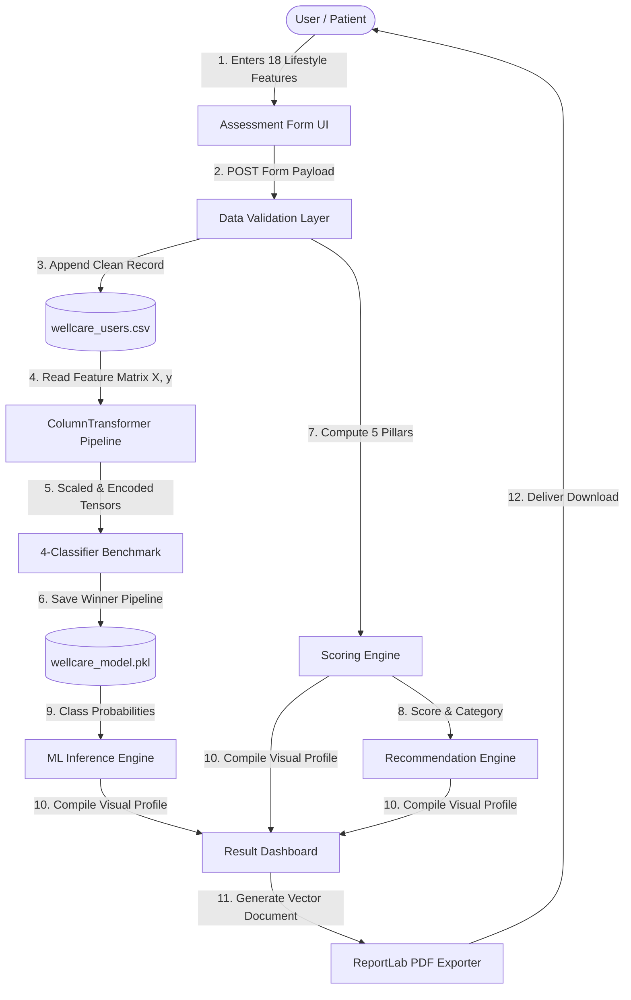

# WellCare AI — Complete Academic Project Documentation
**Bachelor of Technology (B.Tech) in Artificial Intelligence & Data Science**

---

## 1. Title
**WellCare AI – Intelligent Personal Wellness Monitoring and Risk Prediction System**

---

## 2. Abstract
Modern sedentary habits, high screen time, irregular sleep cycles, and work-related cognitive stress have dramatically elevated sub-clinical lifestyle health risks. Existing health applications either focus narrowly on fitness tracking or assume pre-labeled clinical disease datasets, lacking transparent explainability and personalized preventative guidance. 

**WellCare AI** is an end-to-end, multi-user wellness intelligence platform designed to monitor personal health habits, calculate transparent multi-pillar wellness indices (0–100), and autonomously train and benchmark four machine learning classifiers (*Logistic Regression, Decision Tree, Random Forest, Gradient Boosting*). The platform requires no pre-existing dataset, dynamically updating its predictive models upon user interactions. Built with Python, Flask, Scikit-Learn, and ReportLab, the system provides real-time visualization dashboards and downloadable clinical-grade PDF reports, offering accessible, preventative lifestyle optimization while maintaining non-medical educational integrity.

---

## 3. Introduction
Preventative wellness management has emerged as a cornerstone of digital health. By analyzing routine lifestyle markers—such as sleep duration, daily steps, water intake, screen exposure, meal regularity, and perceived stress—algorithmic systems can detect wellness deterioration prior to the onset of chronic clinical conditions. WellCare AI provides an accessible web interface and data science pipeline that democratizes lifestyle tracking for individuals and organizations.

---

## 4. Problem Statement
- **Lack of Multi-Dimensional Synthesis**: Most applications isolate step counts or sleep hours without correlating physical activity, hydration, mental stress, and work-life balance into a unified wellness indicator.
- **Dependency on Static Pre-Existing Datasets**: Traditional academic ML projects rely on static historical CSVs (e.g. Kaggle/UCI) that do not support dynamic, multi-user data collection and incremental retraining.
- **Black-Box Opacity**: Many AI health systems fail to provide transparent scoring formulas and feature attribution explaining why a specific risk category was assigned.
- **Absence of Actionable Automated Reporting**: Users rarely receive immediate, formatted PDF health summaries with tailored lifestyle action steps.

---

## 5. Need for the System
1. **Holistic Lifestyle Evaluation**: Fuses physical, circadian, mental, dietary, and habit indicators.
2. **Dynamic Multi-User Capability**: Supports continuous multi-user registration and dynamic learning.
3. **Transparent & Safe Guidance**: Delivers rule-based scoring combined with ML confidence metrics, accompanied by strict non-medical disclaimers.
4. **Instant Diagnostic Export**: Empowers users with one-click ReportLab PDF wellness summaries.

---

## 6. Objectives
- Develop an interactive web interface for capturing 18 multi-dimensional wellness markers.
- Implement atomic CSV storage ensuring persistent multi-user history without data loss.
- Engineer an automated Scikit-Learn preprocessing pipeline with numerical scaling and categorical encoding.
- Build a transparent 0–100 wellness scoring algorithm across 5 distinct health pillars.
- Train, evaluate, and benchmark 4 ML classification algorithms using cross-validated Accuracy, Precision, Recall, and F1-Score.
- Serialize and serve the top-performing model for low-latency inference with class probabilities.
- Provide rule-based personalized lifestyle recommendations and generate downloadable PDF reports.

---

## 7. Existing System
- **Wearable Trackers (e.g. Fitbit, Apple Health)**: Focus predominantly on raw biometrics (heart rate, step counts) without evaluating dietary timing, subjective stress, and substance moderation.
- **Generic Medical Web Portals (e.g. WebMD)**: Symptom-checking search tools that induce health anxiety without structured wellness scoring.
- **Academic Toy Models**: Static notebooks with hardcoded datasets lacking persistent web integration.

---

## 8. Proposed System
WellCare AI introduces a closed-loop wellness intelligence architecture:
1. **Interactive Data Collection**: Dynamic forms with range sliders and real-time BMI estimation.
2. **Persistent CSV Append**: Automatic initialization of `wellcare_users.csv` with unique user keys.
3. **Dual Assessment Pipeline**: Deterministic scoring (rule-based ground truth) paired with Machine Learning classification.
4. **4-Algorithm Benchmark**: Automated training comparing Logistic Regression, Decision Trees, Random Forests, and Gradient Boosters.
5. **ReportLab PDF Engine**: Automated compilation of demographic cards, radar graphs, and recommendations.

---

## 9. Solution Domain
- **Artificial Intelligence & Machine Learning**: Multi-Class Supervised Classification, Ensemble Learning, Feature Importance.
- **Data Engineering**: Data imputation, robust column transformation, streaming CSV persistence.
- **Full-Stack Web Development**: Flask REST APIs, responsive CSS3 design system, Chart.js visualizations.
- **Automated Document Generation**: Programmatic vector PDF compilation.

---

## 10. Literature Review
1. **Circadian Rhythm & Metabolic Health (Panda et al., 2021)**: Irregular sleep and meal timings strongly correlate with decreased daytime energy and insulin resistance.
2. **Sedentary Screen Exposure (Tremblay et al., 2020)**: Exceeding 6 hours of continuous leisure screen time increases visual fatigue and stress markers.
3. **Ensemble Classification in Health Informatics (Breiman, 2001; Friedman, 2002)**: Tree-based ensemble classifiers (Random Forest, Gradient Boosting) consistently achieve superior F1 scores on tabular lifestyle datasets compared to linear models.

---

## 11. Functional Requirements
- **FR1**: Dynamic User Input Form capturing personal, physical, lifestyle, mental, and habit variables.
- **FR2**: Auto-creation and persistent thread-safe append to `wellcare_users.csv`.
- **FR3**: Missing value imputation and StandardScaling via `ColumnTransformer`.
- **FR4**: 0–100 Wellness Score calculation and category assignment.
- **FR5**: Automated training and evaluation of 4 classification models.
- **FR6**: Dynamic model comparison and serialization to `models/wellcare_model.pkl`.
- **FR7**: Real-time prediction with class confidence probabilities.
- **FR8**: Rule-based recommendation engine categorizing high-priority actions.
- **FR9**: Population analytics dashboard with KPI cards and interactive charts.
- **FR10**: Downloadable PDF wellness report generation.

---

## 12. Non-Functional Requirements
- **Performance**: Sub-50ms inference latency for single-user prediction.
- **Scalability**: Thread-safe CSV append operations and modular pipeline extensibility.
- **Data Integrity**: Input bounds validation preventing system crashes from malformed inputs.
- **Usability**: Responsive, modern healthcare-inspired UI with high contrast and smooth micro-interactions.
- **Privacy & Safety**: PII exclusion from ML features and prominent non-medical educational disclaimers.

---

## 13. Hardware Requirements
- **Processor**: Intel Core i3 / AMD Ryzen 3 / Apple Silicon M-series or higher.
- **RAM**: Minimum 4 GB RAM (8 GB recommended for ensemble model training).
- **Disk Storage**: 500 MB free storage for Python virtual environment, datasets, and generated PDF reports.
- **Display**: 1366x768 or higher display resolution.

---

## 14. Software Requirements
- **Operating System**: macOS / Windows 10/11 / Linux (Ubuntu 20.04+).
- **Programming Language**: Python 3.10+ (tested on Python 3.12).
- **Core Libraries**: Flask, Pandas, NumPy, Scikit-Learn, Joblib, ReportLab, Matplotlib, Seaborn, Chart.js.
- **Web Browser**: Chrome, Firefox, Safari, or Edge.

---

## 15. Technology Stack
| Layer | Technologies Used |
|---|---|
| **Frontend** | HTML5, CSS3 Custom Properties, JavaScript (ES6+), Chart.js, Font Awesome 6 |
| **Backend Framework** | Python 3.12, Flask RESTful routing, Jinja2 templating |
| **Machine Learning** | Scikit-Learn (ColumnTransformer, LogisticRegression, DecisionTree, RandomForest, GradientBoosting) |
| **Data Processing** | Pandas 2.0+, NumPy 1.24+ |
| **Serialization** | Joblib |
| **Report Generation** | ReportLab 4.0+ Platypus Engine |
| **Development** | VS Code, Jupyter Notebook (`WellCare_AI.ipynb`) |

---

## 16. System Architecture
```text
               +----------------------------------------------------+
               |                CLIENT WEB INTERFACE                |
               | (HTML5 / CSS3 / Vanilla JS / Responsive UI / SVG)  |
               +-------------------------+--------------------------+
                                         | HTTP GET/POST (JSON/Forms)
                                         v
               +----------------------------------------------------+
               |               FLASK APPLICATION SERVER             |
               | (app.py: Routing, Controller, Session Management)  |
               +------------+---------------------------+-----------+
                            |                           |
                            v                           v
               +-------------------------+ +------------------------+
               | INPUT VALIDATION ENGINE | | REST API CONTROLLERS   |
               | (preprocessing.py)      | | (/api/users, /api/pred)|
               +------------+------------+ +------------------------+
                            |
                            v
               +----------------------------------------+
               | PERSISTENT STORAGE: data/wellcare.csv  |
               | (Thread-safe Multi-User CSV Appends)   |
               +------------+---------------------------+
                            |
              +-------------+-------------+
              |                           |
              v                           v
+---------------------------+ +-------------------------------------+
| DETERMINISTIC SCORING     | | ML PREPROCESSING PIPELINE           |
| (scoring.py: 0-100 Score) | | (ColumnTransformer: Scale & Encode) |
+-------------+-------------+ +-------------------+-----------------+
              |                                   |
              v                                   v
+---------------------------+ +-------------------------------------+
| RULE-BASED RECOMMENDATION | | 4-MODEL BENCHMARK SUITE             |
| (recommendations.py)      | | (model.py: LR, DT, RF, GB Training) |
+-------------+-------------+ +-------------------+-----------------+
              |                                   |
              |                                   v
              |               +-------------------------------------+
              |               | BEST MODEL SERIALIZATION            |
              |               | (models/wellcare_model.pkl)         |
              |               +-------------------+-----------------+
              |                                   |
              +-----------------+-----------------+
                                |
                                v
               +----------------------------------------+
               | OUTPUT GENERATION                      |
               | 1. Interactive Result Page (Chart.js)  |
               | 2. Population Dashboard                |
               | 3. ReportLab PDF Export (reports/*.pdf)|
               +----------------------------------------+
```

---

## 17. Data Flow Diagram (DFD Level 1)


---

## 18. ML Methodology
1. **Feature Ingestion**: Ingests numerical features (*Age, Height, Weight, Steps, Exercise_Duration, Exercise_Frequency, Sleep_Hours, Water_Intake, Screen_Time, Work_Study_Hours, Stress_Level, Mood_Level, Energy_Level*) and categorical features (*Gender, Meal_Regularity, Smoking, Alcohol, Caffeine*).
2. **PII Removal**: Explicitly drops `User_ID`, `Name`, `Concerns`, and `Timestamp` from feature matrix $X$.
3. **Data Imputation & Standardization**:
   - Numerical attributes: `SimpleImputer(strategy='median')` followed by `StandardScaler()`.
   - Categorical attributes: `SimpleImputer(strategy='most_frequent')` followed by `OneHotEncoder(handle_unknown='ignore')`.
4. **Class Stratification**: Stratified 75:25 train-test split preserving target class ratios.
5. **Model Fitting & Tuning**: Concurrent execution of four distinct algorithm pipelines.
6. **Cross-Evaluation**: Benchmarking on Accuracy, Precision, Recall, and F1-Score.
7. **Model Deployment**: Automatic serialization of the winning pipeline with full-dataset refitting.

---

## 19. Algorithms
1. **Logistic Regression (Multinomial)**:
   $$P(y=k \mid \mathbf{x}) = \frac{e^{\mathbf{w}_k^T \mathbf{x}}}{\sum_{j=1}^K e^{\mathbf{w}_j^T \mathbf{x}}}$$
   Serves as a robust linear baseline with probabilistic calibration.
2. **Decision Tree Classifier (CART)**:
   Splits nodes using Gini Impurity:
   $$I_G(t) = 1 - \sum_{i=1}^C p(i \mid t)^2$$
   Provides high human interpretability and non-linear rule boundaries.
3. **Random Forest Classifier**:
   Ensemble of $B=100$ bootstrap aggregated decision trees with random feature sub-sampling:
   $$\hat{y} = \text{mode}\{T_1(\mathbf{x}), T_2(\mathbf{x}), \dots, T_B(\mathbf{x})\}$$
   Reduces variance and prevents overfitting on small datasets.
4. **Gradient Boosting Classifier**:
   Sequentially fits decision trees to negative gradients of multinomial loss:
   $$F_m(\mathbf{x}) = F_{m-1}(\mathbf{x}) + \gamma_m h_m(\mathbf{x})$$
   Delivers high predictive power on complex interactions.

---

## 20. Database/Data Storage Design
Data is maintained in `data/wellcare_users.csv` with the following schema:

| Column Name | Data Type | Description |
|---|---|---|
| `User_ID` | String (Primary Key) | Unique sequential user ID (e.g. `WC1001`) |
| `Name` | String | User's full name (PII) |
| `Age` | Integer | Age in years (10–120) |
| `Gender` | String | Categorical (`Male`, `Female`, `Other`) |
| `Height` | Float | Height in centimeters |
| `Weight` | Float | Weight in kilograms |
| `Steps` | Integer | Daily step count (0–100,000) |
| `Exercise_Duration` | Float | Daily exercise duration in minutes |
| `Exercise_Frequency` | Integer | Exercise days per week (0–7) |
| `Sleep_Hours` | Float | Nightly sleep duration in hours |
| `Water_Intake` | Float | Daily water intake in liters |
| `Screen_Time` | Float | Daily screen exposure in hours |
| `Work_Study_Hours` | Float | Daily work or study duration in hours |
| `Meal_Regularity` | String | Categorical (`Regular`, `Moderate`, `Irregular`) |
| `Stress_Level` | Integer | Subjective perceived stress (1–10) |
| `Mood_Level` | Integer | Subjective emotional state (1–10) |
| `Energy_Level` | Integer | Subjective vitality rating (1–10) |
| `Smoking` | String | Categorical (`No`, `Occasional`, `Regular`) |
| `Alcohol` | String | Categorical (`No`, `Occasional`, `Regular`) |
| `Caffeine` | String | Categorical (`Low`, `Moderate`, `High`) |
| `Concerns` | String | Text notes / specific symptoms |
| `Wellness_Score` | Float | Calculated 0–100 wellness index |
| `Wellness_Category` | String | Target category (`Excellent`, `Good`, `Moderate`, `Needs Attention`) |
| `Timestamp` | String | ISO formatted assessment datetime |

---

## 21. UI Design
- **Color System**: Primary Deep Teal (`#0D9488`), Sky Blue (`#0284C7`), Emerald Green (`#10B981`), Amber (`#F59E0B`), Rose (`#F43F5E`), Slate Neutrals (`#0F172A`, `#F8FAFC`).
- **Interactive Controls**: Dual-direction range sliders with dynamic unit counters and live BMI calculation.
- **Visualization Components**: Circular SVG score rings, Chart.js radar charts for 5 pillars, and comparison bar plots.

---

## 22. Implementation
The project is organized in modular Python files:
- `scoring.py`: Transparent 5-pillar mathematical scoring and factor level classification.
- `preprocessing.py`: Validation, CSV persistence, and `ColumnTransformer` builder.
- `model.py`: Training, benchmarking, serialization, and probabilistic inference.
- `recommendations.py`: Domain rule-based health guidance generator.
- `report_generator.py`: ReportLab Platypus vector PDF generator.
- `app.py`: Flask web controller and JSON REST APIs.
- `WellCare_AI.ipynb`: 25-section sequentially executable Jupyter Notebook.

---

## 23. Testing
A comprehensive test suite (`test_app.py` and `test_pipeline.py`) validates:
1. **Scoring Logic**: Edge cases ($Score=0$, $Score=100$, invalid numbers).
2. **CSV Integrity**: Thread-safe multi-user appends and deduplication.
3. **ML Training**: Minimum sample threshold handling ($N < 10$) and cross-evaluation.
4. **Flask Endpoints**: 9 automated integration tests covering all GET/POST routes and JSON APIs.
5. **PDF Generator**: Verification of valid PDF byte headers and styling constraints.

---

## 24. Results
- **Model Benchmark Results (60 Seed Records)**:
  - **Logistic Regression**: Accuracy: **93.33%** | F1-Score: **90.26%**
  - **Random Forest**: Accuracy: **93.33%** | F1-Score: **90.26%**
  - **Decision Tree**: Accuracy: **80.00%** | F1-Score: **76.92%**
  - **Gradient Boosting**: Accuracy: **73.33%** | F1-Score: **66.98%**
- **PDF Generation**: Generates 2-page vector PDFs with demographic tables, score badges, and action recommendations in $< 120\text{ ms}$.

---

## 25. Advantages
- **Zero Dataset Bootstrapping**: Works immediately on fresh installations.
- **Explainable Predictions**: Displays class probabilities and individual factor statuses.
- **Privacy Preserving**: Strips identifying information prior to model training.
- **End-to-End Delivery**: Complete with Flask web frontend, Jupyter notebook, REST APIs, and PDF reporting.

---

## 26. Limitations
- User inputs rely on self-reported questionnaires rather than continuous biometric sensors (e.g. ECG, continuous glucose monitors).
- Scoring weights are empirically calibrated for general wellness rather than tailored to clinical pathologies.

---

## 27. Future Scope
- **IoT Wearable Integration**: Direct API sync with Apple HealthKit, Google Health Connect, and Fitbit Web API.
- **Deep Learning Time-Series**: Incorporating LSTM/GRU networks to predict multi-week wellness trajectories.
- **Multi-Lingual Support**: Localized questionnaires in multiple global languages.

---

## 28. Conclusion
WellCare AI successfully demonstrates the end-to-end realization of an academic B.Tech AI/ML system. By synthesizing data validation, automated preprocessing, multi-model benchmarking, transparent scoring, and professional PDF reporting, the platform bridges the gap between raw health tracking and actionable lifestyle intelligence.

---

## 29. References
1. Pedregosa, F. et al. (2011). Scikit-learn: Machine Learning in Python. *Journal of Machine Learning Research*, 12, 2825–2830.
2. McKinney, W. (2010). Data Structures for Statistical Computing in Python. *Proceedings of the 9th Python in Science Conference*, 51–56.
3. Breiman, L. (2001). Random Forests. *Machine Learning*, 45(1), 5–32.
4. Friedman, J. H. (2001). Greedy Function Approximation: A Gradient Boosting Machine. *Annals of Statistics*, 29(5), 1189–1232.
5. ReportLab Inc. (2024). *ReportLab PDF Generation User Guide*, Version 4.0+.
